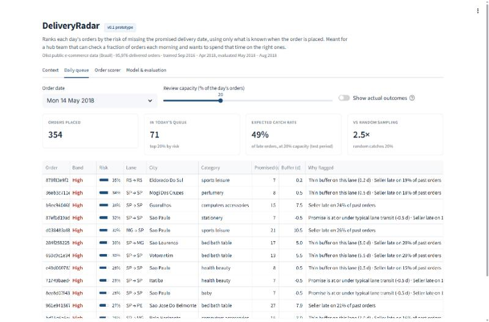

# DeliveryRadar

Scores e-commerce orders for the risk of arriving after the promised date, at the moment the order is placed, so a hub team can work through the riskiest ones first. It is built around how Indian marketplaces run fulfilment (seller or FC, sort hub, 3PL, last mile). It is trained on Brazilian data because no public Indian dataset has promised and actual delivery dates.

**Live app:** [delivery-radar-pawan.streamlit.app](https://delivery-radar-pawan.streamlit.app/) · **Product write-up:** [PRD.md](PRD.md)



## Background

During my internship on Flipkart's issue resolution team, most of the work started after a shipment had already gone wrong: a missing package, a damaged one, a customer chasing an update. I wanted to see how much of that could be spotted on day one, using only information available when the order is placed.

There's no public Indian dataset with this level of detail, so this uses the [Olist Brazilian e-commerce dataset](https://www.kaggle.com/datasets/olistbr/brazilian-ecommerce). It has about 96k delivered orders from 2016 to 2018, with promised dates, actual delivery dates and reviews.

The data makes the cost clear. On-time orders average 4.3 out of 5 and late ones 2.3. Ratings barely change with delivery speed as long as the promised date is met, and drop sharply once it is missed.

## Results

Trained on Sep 2016 to Apr 2018 and tested on the following four months (25,239 orders). "Capture @ X%" is the share of all late orders that land in the top X% of orders ranked by score. That's the number that matters when a team can only check a fraction of orders each day.

| Approach | ROC-AUC | Capture @10% | Capture @20% |
|---|---|---|---|
| Random sampling | 0.50 | 10% | 20% |
| Rule: distance ÷ promised days | 0.56 | 19% | 31% |
| Gradient boosting, 21 features | 0.68 | 25% | 40% |
| Logistic regression, 2 features (used) | 0.74 | 30% | 49% |

Checking 20% of orders catches about half of the late ones.

## What the model uses

1. **Delivery buffer:** promised days minus the typical transit time on that lane (seller state to customer state), computed only from earlier orders.
2. **Seller late rate:** the seller's share of past orders that arrived late, shrunk toward the overall average so that new sellers aren't scored at the extremes.

The 21-feature gradient-boosted model looked like the obvious choice, but it did worse on the test months. In mid-2018 the platform started promising shorter delivery windows (median promise fell from about 24 days to 13–19), and the bigger model had learned the earlier pattern. The buffer feature compares each promise to how long deliveries on that lane actually take, so it held up. A two-feature model is also much easier to explain to whoever has to act on a flag.

## The app

- **Overview:** how delivery outcomes relate to reviews, and how the late rate moves over time and by state.
- **Daily risk queue:** pick a day and how many orders your team can check; the riskiest orders come first, with why each was flagged and what to do. Filter by band, reveal what actually happened, or download the queue as CSV.
- **Check an order:** pick a route, a promise and a seller's track record to get a risk score. It also shows how the risk changes with the promise, so you can find the shortest promise that stays low risk.
- **India playbook:** how each input maps to an Indian marketplace, where Indian networks get stressed, actions in Indian ops terms, a scorer for Indian lanes using your own transit numbers, and a rollout plan.
- **How it works:** the comparison above, capture curves and known limitations.

## Applying it in India

The two inputs aren't specific to Brazil; the fitted numbers are. At an Indian marketplace I would change four things:

- **Lanes at pin-code-cluster level**, not state level, and split by 3PL partner and surface vs air. Pune to Mumbai and Pune to a rural Maharashtra pin code are different lanes.
- **Seller reliability that includes dispatch-SLA breaches**, i.e. handing over after the cut-off. For FC-fulfilled orders, use FC dispatch performance.
- **Calendar flags** for festive sales (September to November, Diwali) and monsoon (June to September, mostly regional). In Olist, the late rate tripled in the Black Friday month, which is the closest analogue.
- **A COD flag.** A late cash-on-delivery order is a likely RTO, so it's worth combining lateness risk with RTO risk in the same queue.

The High-band action translates to a priority first-mile pickup, a flag to the 3PL's hub, a WhatsApp or SMS ETA update before the customer asks and, for COD, a confirmation call. The rollout I'd propose is shadow mode at one mother hub outside the festive season, then a pilot, then a run through a sale event. The PRD has the details.

## Running it

```bash
pip install -r requirements.txt
streamlit run app.py
```

The app reads the pre-built files in `artifacts/`. To rebuild them, download the Olist CSVs into `data/raw/` and run:

```bash
python src/data_prep.py
python src/train.py
```

```
app.py              Streamlit app
src/data_prep.py    raw CSVs to one row per order, with features
src/train.py        training, evaluation, exports for the app
artifacts/          model and precomputed tables
PRD.md              product write-up: users, metrics, rollout
docs/               screenshots
```

## Limitations

- Seller late rate is calculated from past orders whose outcome might not have been known yet on the scoring date. A production version should only count orders whose promised date has passed, so the numbers above may be slightly optimistic.
- About 1 in 8 High-risk orders is actually late. That's roughly 3× the base rate, but it means the action on a flag has to be cheap.
- There's no courier tracking data. Re-scoring an order when it misses a scan milestone is the obvious next step.
- It's Brazilian data. The approach should transfer to Indian networks, but the coefficients, thresholds and lane transit times have to be rebuilt (see above).

---

Pawan Rathod · MBA, Operations & Supply Chain. Data is CC BY-NC-SA 4.0 (Olist).
