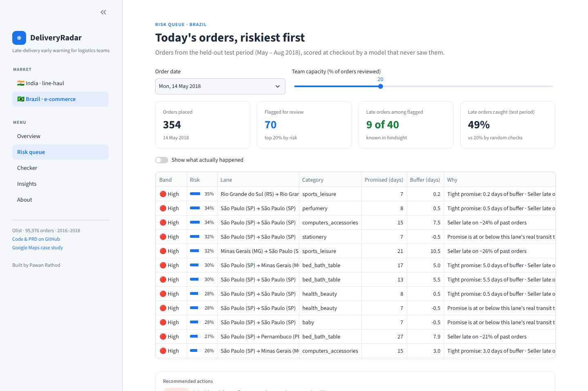
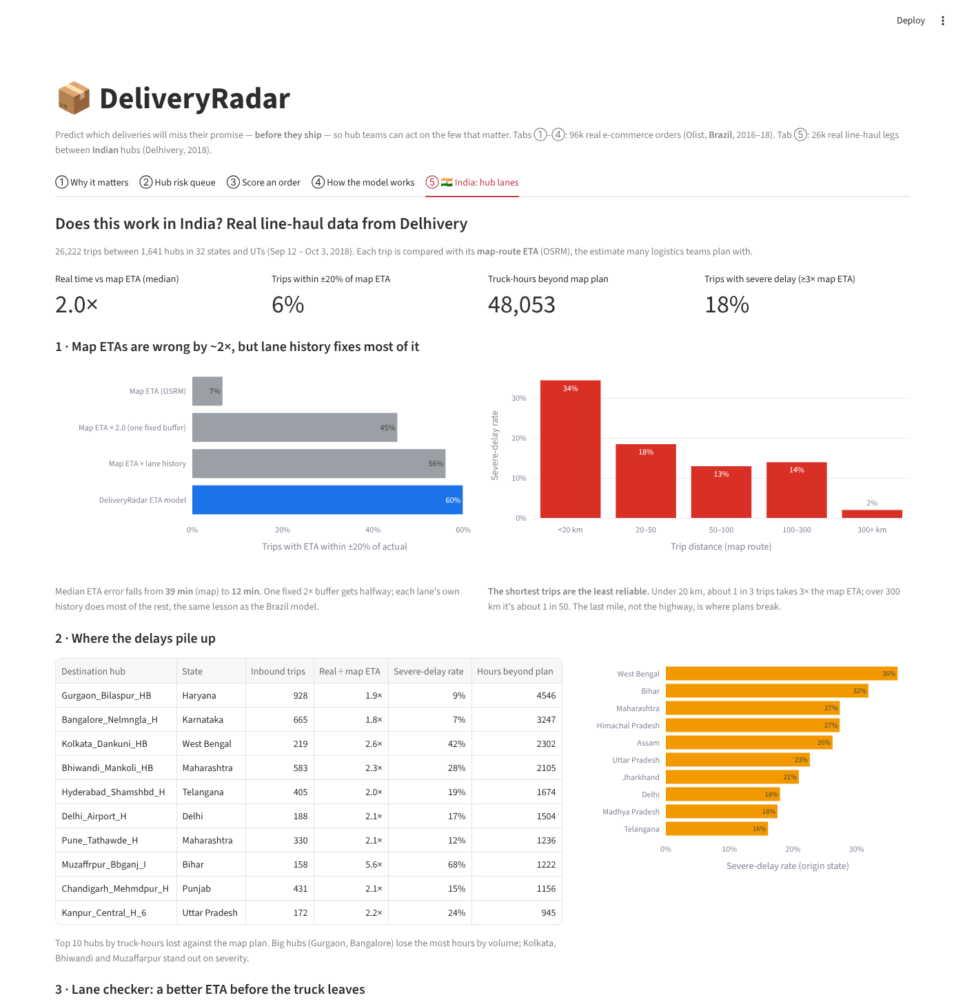

# 📦 DeliveryRadar: predict late deliveries before they ship

**Live app:** _<add your Streamlit link>_ · **PRD:** [PRD.md](PRD.md) · **Related case study:** [Google Maps Doorstep](https://github.com/Rathore-Sahab/google-maps-doorstep-case-study)

Late deliveries wreck customer trust. Across 96k real e-commerce orders, on-time orders average **4.3★** while late ones average **2.3★**, and **61%** of late orders get a 1–2★ review. Ops teams usually find out *after* the fact.

DeliveryRadar scores every order **at the moment it's placed** and gives hub teams a daily risk queue, with a reason and a suggested action for each flag. It's built on two real datasets: **96k e-commerce orders from Brazil** (Olist) and **26k line-haul trips between Indian hubs** (Delhivery).



## Results (held-out test period: May–Aug 2018, 25k orders the model never saw)

| Approach | ROC-AUC | Late orders caught reviewing **top 10%** | …**top 20%** |
|---|---|---|---|
| Random checks | 0.50 | 10% | 20% |
| Rule of thumb (distance ÷ promised days) | 0.56 | 19% | 31% |
| Gradient-boosted model, 21 features | 0.68 | 25% | 40% |
| **DeliveryRadar: 2 signals, logistic regression** | **0.74** | **30%** | **49%** |

**Headline:** a team that reviews 1 in 5 orders catches about **half of all late deliveries** in advance. That is 2.5× random checking and 1.6× the rule of thumb.

## 🇮🇳 India: Delhivery hub lanes

Does the idea hold in India? I applied it to **26,222 real trips between 1,641 Delhivery hubs in 32 states and UTs** (Sep–Oct 2018). Each trip is compared with its map-route ETA (OSRM).

| Finding | Number |
|---|---|
| Real transit time vs map ETA (median) | **2.0×** |
| Trips arriving within ±20% of the map ETA | **6%** |
| Truck-hours beyond the map plan | **~48,000** |
| Severe-delay rate (≥3× map ETA) on trips under 20 km vs over 300 km | **34% vs 2%**. The last mile is where plans break. |

| ETA method (held-out week, Sep 27 – Oct 3) | Within ±20% of actual | Median error |
|---|---|---|
| Map ETA | 7% | 39 min |
| Map ETA × one fixed 2× buffer | 45% | 19 min |
| Map ETA × lane history | 56% | 14 min |
| **DeliveryRadar ETA model** | **60%** | **12 min** |

Flagging the riskiest 20% of trips catches **64% of severe delays** (ROC-AUC 0.87). Lane history alone gets 62%, the same lesson as Brazil: a lane's own track record is the strongest signal.



## The insight: two simple signals beat 21 features

1. **Delivery buffer** = promised days − how long this lane (seller state → customer state) *really* takes, computed from earlier orders only. Orders with ≤0 days of buffer are late **3.8×** as often as orders with 15+ days.
2. **Seller reliability**: the seller's past late rate, shrunk toward the average for new sellers.

In mid-2018 the platform shortened its delivery promises. The 21-feature model had memorised the old regime and degraded on new data. The buffer signal compares each promise with reality, so it kept working. It is also explainable, which matters when an ops associate has to act on a flag.

## App walkthrough

| Tab | What it shows |
|---|---|
| ① Why it matters | Review score by delivery delay: the promise is the product |
| ② Hub risk queue | A day's orders ranked by risk, with a team-capacity slider, reason codes and a hindsight toggle |
| ③ Score an order | Pick a lane, a promise and seller history to get the risk, the reason and the action. It also works as a "what promise is safe?" tool |
| ④ How the model works | Capture curves, comparison with baselines, limitations |
| ⑤ 🇮🇳 India: hub lanes | Map ETA vs real transit on Delhivery lanes, bottleneck hubs, and a lane checker (e.g. Pune → Bhiwandi) with a better ETA and a severe-delay risk |

## Method

- **Data:** [Olist Brazilian E-Commerce Public Dataset](https://www.kaggle.com/datasets/olistbr/brazilian-ecommerce): 96k delivered orders, 2016–2018 · Delhivery trip dataset (public, shared for educational business cases): 26k hub-to-hub trips in India, Sep–Oct 2018
- **Target:** delivered after the promised (estimated) delivery date
- **No leakage:** time-based split; every history feature uses only earlier orders
- **Metric:** "capture @ capacity", the share of late orders found when reviewing the top X% riskiest orders, because ops capacity is the real constraint

## Run it yourself

```bash
pip install -r requirements.txt
streamlit run app.py              # uses pre-built artifacts/

# to rebuild from raw data: download the Olist CSVs into data/raw/, then
python src/data_prep.py
python src/train.py
# India tab: put the Delhivery CSV at data/raw/delhivery.csv, then
python src/india.py
```

## Repo structure

```
app.py               Streamlit app
src/data_prep.py     raw Olist CSVs → order-level features
src/train.py         model training, evaluation, app artifacts (Brazil)
src/india.py         Delhivery hub-lane ETA + severe-delay models (India)
artifacts/           trained model + precomputed tables (used by the app)
PRD.md               product requirements doc
docs/                screenshots
```

## Limitations & next steps

India data covers hub-to-hub line-haul, not doorstep delivery, and only 3 weeks · no courier scan events (v2: re-score mid-route when a scan milestone is missed) · seller history should use only orders whose promised date has passed · next step: A/B test proactive customer messages for High-risk orders.

---
Built by **Pawan Rathod**: MBA (Operations & SCM), ex-Flipkart Issue Resolution intern. I built this because at Flipkart I spent my days chasing shipments *after* they went wrong.
